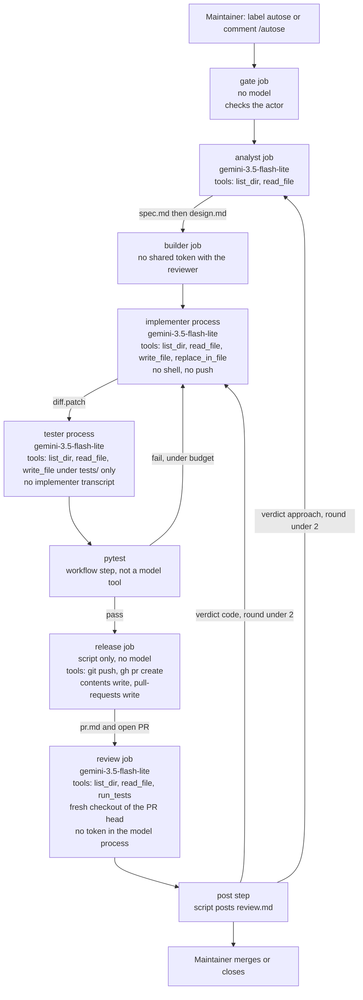

# Component view

The workflow is five Actions jobs with a fixed order: `gate`, `analyst`, `builder`, `release`, `review`. A second review round reuses the review path as `review_again` (ADR-002). The analyst, builder, and review jobs call Gemini. The gate and release jobs do not. Arrows are artifact hand-offs, not a shared conversation.

The analyst reads `ARCHITECTURE.md`, the issue text, and the tree. It cannot push.

The builder job runs two processes one after the other. The tester process is a new Gemini call. Its prompt contains `spec.md`, `design.md`, the diff, and later the pytest log. It does not contain the implementer's messages. The job's `GITHUB_TOKEN` can read the repository. Only the release job can push, and only that job has `pull-requests: write`.

The reviewer process has no `GITHUB_TOKEN` and no git credentials. A script that runs after it posts `review.md`. The model can read the checkout and call `run_tests`, which runs the fixed pytest command and takes no arguments. The model cannot push.

Nothing in this diagram merges the pull request.
