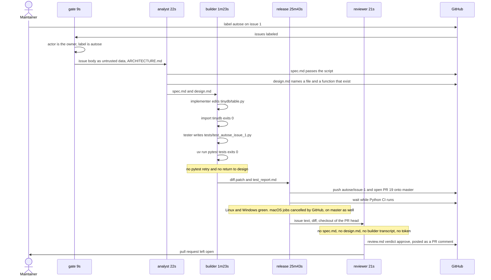

# Sequence view

This is the path of [Actions run 44799110233](https://github.com/Anilkumark17/tinydb/actions/runs/44799110233) on [issue #1](https://github.com/Anilkumark17/tinydb/issues/1). It opened [pull request #19](https://github.com/Anilkumark17/tinydb/pull/19) and posted [the review](https://github.com/Anilkumark17/tinydb/pull/19#issuecomment-7048813902). The verdict was `approve`. No rework job ran.

Every model call in this run used `gemini-3.5-flash-lite`. The reviewer was not a different model. Times are the job times recorded for this run.

The back-edges in the stage map (pytest retry, return to design, `verdict: code`, `verdict: approach`) were not taken on this run. They were also not taken on the finished runs for issues #3, #4, and #5. Issue #2's finished run took this same shape and the reviewer approved a patch that does not fix the bug. That run is [44888518600](https://github.com/Anilkumark17/tinydb/actions/runs/44888518600).
