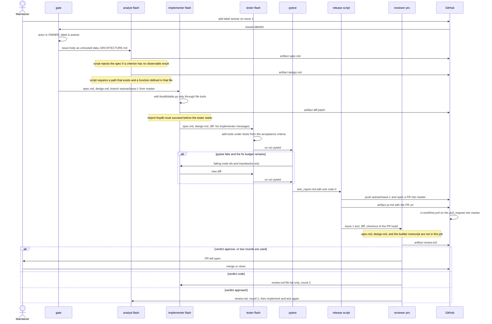

# Sequence view

Planned sequence for a real issue, [tinydb#1](https://github.com/Anilkumark17/tinydb/issues/1) (`update()` / `remove()` with string doc ids). No Actions run exists yet. This is the path the workflow will take for that issue once the runner is built. The issue text and the failing checks below are already true on `edff96a`.

On `edff96a`, `Table.update({'a': 2}, doc_ids=['1'])` returns `[]` and leaves the document unchanged, while `Table.get(doc_id='1')` returns the document. The sequence above is how issue 1 reaches a pull request. It is not a claim that a run has already done so.
